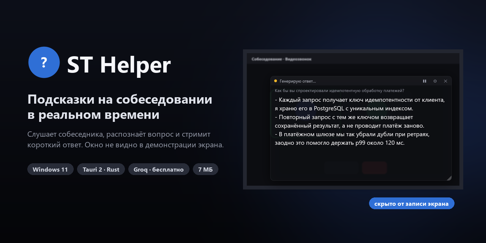
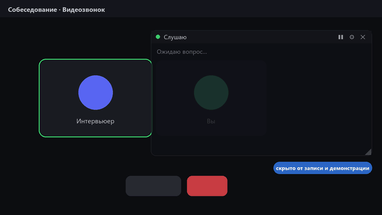
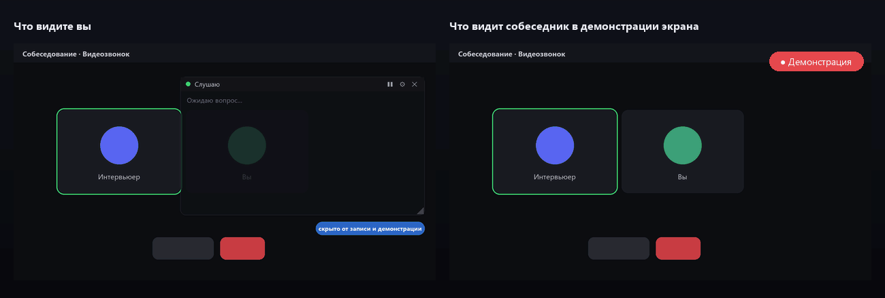
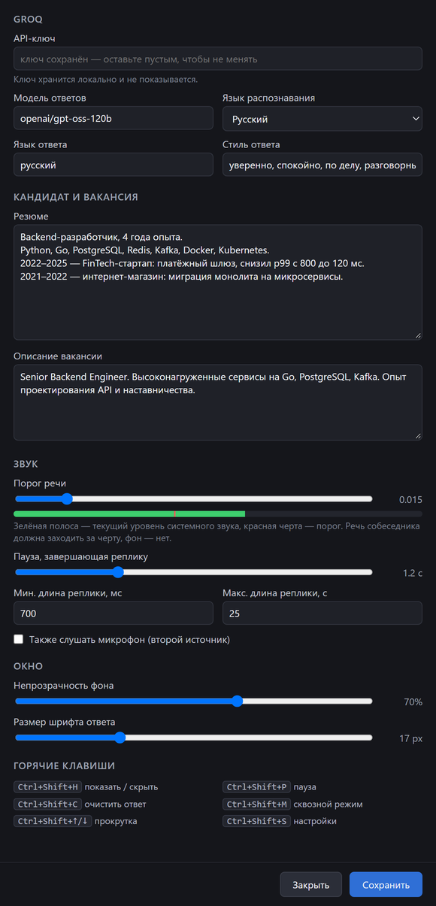
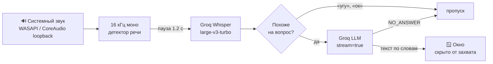

<div align="center">



<p>
  <a href="../../releases/latest"></a>
  <a href="../../releases"></a>
  
  
  
  
  <a href="LICENSE"></a>
</p>

**Слушает собеседника → распознаёт вопрос → за ~1,5 с показывает короткий ответ от первого лица.**<br>
Полупрозрачное окно поверх звонка; защита от захвата зависит от платформы.

[**⬇ Скачать**](../../releases/latest) · [Быстрый старт](#-быстрый-старт) · [Горячие клавиши](#%EF%B8%8F-горячие-клавиши) · [Как это работает](#-как-это-работает)

<br>



</div>

## ✨ Возможности

| | |
|---|---|
| 🙈 **Защита окна** | Windows исключает окно через `WDA_EXCLUDEFROMCAPTURE`; на macOS используется защита окна Tauri, доступность зависит от способа захвата |
| 🎧 **Слушает звонок** | WASAPI loopback на Windows; на macOS — loopback-вход CoreAudio, например BlackHole |
| ⚡ **Быстро** | Whisper `large-v3-turbo` + LLM на Groq, ответ стримится по словам ~1,5 с после конца вопроса |
| 🧠 **Отвечает как вы** | Учитывает резюме и вакансию, не выдумывает опыт, по технике — сначала суть, потом пример |
| 🎯 **Не болтает зря** | «Угу», «понятно», рассказ о компании — ответа не будет, только на вопросы |
| 🖱 **Не мешает** | Сквозной режим: клики проходят сквозь окно; прозрачность и шрифт настраиваются |
| 💸 **Бесплатно** | Один бесплатный ключ Groq, никаких подписок и встроенных моделей |
| 🔒 **Приватно** | Аудио не пишется на диск, ключ хранится локально и не уходит во фронтенд |

## 🙈 Что видит собеседник

<div align="center">

</div>

На Windows окна подсказок и настроек исключаются из захвата системным флагом `WDA_EXCLUDEFROMCAPTURE`.
На macOS включается поддерживаемая Tauri защита содержимого окна, но поведение зависит от приложения для записи
и версии macOS — проверьте его заранее.

> [!NOTE]
> Анимации выше нарисованы скриптом [`docs/make_assets.py`](docs/make_assets.py) по настоящему интерфейсу:
> записать живое окно невозможно — на то и защита. Скриншоты ниже — рендер реальных `index.html` / `settings.html`.

## 🚀 Быстрый старт

1. **Windows:** скачайте [`ST-Helper.exe`](../../releases/latest) (портативный) или установщик.
   **macOS:** соберите приложение по инструкции ниже; для захвата системного звука установите BlackHole 2ch,
   задайте его входом по умолчанию и направьте звук системы в BlackHole (при необходимости через Multi-Output Device).
2. **Получите ключ** на [console.groq.com](https://console.groq.com/keys) — бесплатно, по почте или Google.
3. **Запустите**, нажмите `Ctrl+Shift+S` (Windows) или `Cmd+Shift+S` (macOS), вставьте ключ, по желанию резюме и описание вакансии → «Сохранить».
4. Включите любое видео с вопросами — окно покажет «Распознаю…», «Генерирую ответ…» и сам ответ.

> [!TIP]
> Если речь не ловится или ловится фоновая музыка — подвиньте «Порог речи» в настройках:
> речь собеседника должна заходить за красную черту на индикаторе уровня.

## ⚙️ Настройки

<table>
<tr>
<td width="46%"></td>
<td>

Хранятся локально: Windows — `%APPDATA%\com.sthelper.overlay\settings.json`;
macOS — `~/Library/Application Support/com.sthelper.overlay/settings.json`.

| Параметр | По умолчанию |
|---|---|
| Модель | `openai/gpt-oss-120b` |
| Язык распознавания | `ru` (пусто — авто) |
| Язык ответа | русский |
| Порог речи (RMS) | 0.015 |
| Пауза конца реплики | 1.2 с |
| Мин. / макс. реплика | 0.7 с / 25 с |
| Непрозрачность | 70% |
| Микрофон | выключен |

Модель меняется на любую из [списка Groq](https://console.groq.com/docs/models).
На Windows микрофон можно включить как второй источник. На macOS приложение слушает выбранный вход: для собеседника
из звонка направьте системный звук в BlackHole; дополнительный микрофонный поток пока не поддерживается.

Ключ лежит в файле открытым текстом, в репозиторий и интерфейс не попадает.

</td>
</tr>
</table>

## ⌨️ Горячие клавиши

Работают глобально, даже когда в фокусе звонок. На Windows используется `Ctrl+Shift`, на macOS — `Cmd+Shift`.
Все заданы в одном месте — [`src-tauri/src/hotkeys.rs`](src-tauri/src/hotkeys.rs).

| Клавиши | Действие |
|---|---|
| <kbd>Ctrl</kbd>+<kbd>Shift</kbd>+<kbd>H</kbd> | показать / скрыть окно |
| <kbd>Ctrl</kbd>+<kbd>Shift</kbd>+<kbd>C</kbd> | очистить ответ и остановить генерацию |
| <kbd>Ctrl</kbd>+<kbd>Shift</kbd>+<kbd>↑</kbd> / <kbd>↓</kbd> | прокрутка ответа |
| <kbd>Ctrl</kbd>+<kbd>Shift</kbd>+<kbd>P</kbd> | пауза / продолжить прослушивание |
| <kbd>Ctrl</kbd>+<kbd>Shift</kbd>+<kbd>M</kbd> | сквозной режим (мышь проходит сквозь окно) |
| <kbd>Ctrl</kbd>+<kbd>Shift</kbd>+<kbd>S</kbd> | настройки |

В обычном режиме окно перетаскивается за верхнюю полоску, размер меняется уголком справа внизу.

> [!WARNING]
> В Microsoft Teams <kbd>Ctrl</kbd>+<kbd>Shift</kbd>+<kbd>M</kbd> выключает микрофон. Если пользуетесь Teams — поменяйте
> комбинацию в `hotkeys.rs`. Занятые другими программами клавиши приложение покажет в строке статуса при запуске.

## 🔍 Как это работает



- **Звук.** `cpal` использует WASAPI loopback на Windows. На macOS системное аудио нужно подать на выбранный вход
  через BlackHole или другое loopback-устройство; смена входа подхватывается автоматически. Энергетический детектор речи со сглаживанием: реплика заканчивается после паузы,
  тишина и обрывки короче 0,7 с не отправляются, длинные монологи режутся на 25 с. Аудио на диск не пишется.
- **Распознавание.** WAV собирается в памяти и уходит multipart-запросом. Сегменты, которые Whisper сам считает
  «не речью», и его типичные галлюцинации («Продолжение следует…») отбрасываются.
- **Вопрос или нет — без лишней задержки.** Короткие реплики без признаков вопроса отсекает эвристика. Остальное сразу
  идёт в генерацию, а промпт велит модели ответить `NO_ANSWER`, если отвечать не на что, — отдельного запроса нет.
- **Ответ.** Контекст — последние 6 реплик. Новый вопрос перехватывает окно у предыдущего ответа.
  Сетевые ошибки и лимиты Groq показываются в строке статуса, приложение не падает.
- **Безопасность.** Все HTTP-запросы делает Rust (`reqwest`); фронтенд получает только текст через события Tauri.

<details>
<summary><b>🛠 Сборка из исходников</b></summary>

<br>

Для Windows понадобятся:
- Node.js 18+
- Rust stable, toolchain `x86_64-pc-windows-msvc` — [rustup.rs](https://rustup.rs)
- Visual Studio Build Tools 2022 с «Desktop development with C++»
- WebView2 Runtime (в Windows 11 уже есть)

Для macOS понадобятся:
- Node.js 18+
- Rust stable — [rustup.rs](https://rustup.rs)
- Xcode Command Line Tools (`xcode-select --install`)

```bash
npm install
```

```bash
npm run tauri dev
```

```bash
npm run tauri build
```

Результат на Windows: `src-tauri/target/release/st-helper.exe` и установщик в `src-tauri/target/release/bundle/nsis/`.
На macOS: `.app` в `src-tauri/target/release/bundle/macos/` и `.dmg` в `src-tauri/target/release/bundle/dmg/`.
GitHub Actions собирает Windows, macOS Apple Silicon и Intel при обновлении `main`; push тега `v*` дополнительно
публикует GitHub Release с установщиками. macOS-сборки не подписаны Developer ID и не прошли нотариальную проверку
Apple, поэтому Gatekeeper может попросить вручную подтвердить первый запуск.
Кэш сборки Rust (`src-tauri/target`) занимает несколько гигабайт; после сборки его можно удалить командой
`cargo clean --manifest-path src-tauri/Cargo.toml`.

**Отладка.** В debug-сборке переменная `ST_HELPER_NO_PROTECT=1` отключает защиту от захвата, чтобы снять скриншот,
а в консоль пишутся длительность реплик и задержки запросов (без содержимого). В release этого нет.

**Картинки README** пересобираются так (PNG — рендер `src/index.html` и `src/settings.html` в headless-браузере):

```bash
python docs/make_assets.py overlay.png settings.png
```

```
src/                 фронтенд: index.html (окно), settings.html, без фреймворков
src-tauri/src/
  main.rs            окна, защита от захвата, команды, состояние
  audio.rs           loopback/микрофон, ресемплинг, детектор речи
  groq.rs            Whisper и стриминг chat completions
  pipeline.rs        очередь реплик, фильтр вопросов, системный промпт
  hotkeys.rs         все глобальные горячие клавиши
  settings.rs        настройки и их хранение
```

</details>

<details>
<summary><b>❓ Вопросы</b></summary>

<br>

**Точно не видно в демонстрации?** На Windows защита работает через системный флаг Windows 10 2004+ и 11. На macOS
результат зависит от API захвата и приложения. Перед важным звонком проверьте демонстрацию экрана и запись.

**Слышит мой голос?** По умолчанию нет — только системный звук (то, что слышите вы). Микрофон включается в настройках.

**Сколько стоит?** Ничего: бесплатного лимита Groq обычно хватает на собеседование. При превышении появится
сообщение «лимит запросов», через минуту всё продолжит работать.

**Ловит музыку и шум.** Поднимите порог речи; во время звонка лучше выключить фоновое видео.

</details>

## 📄 Лицензия

[MIT](LICENSE). Используйте честно: инструмент помогает собраться с мыслями, а не заменяет подготовку.
